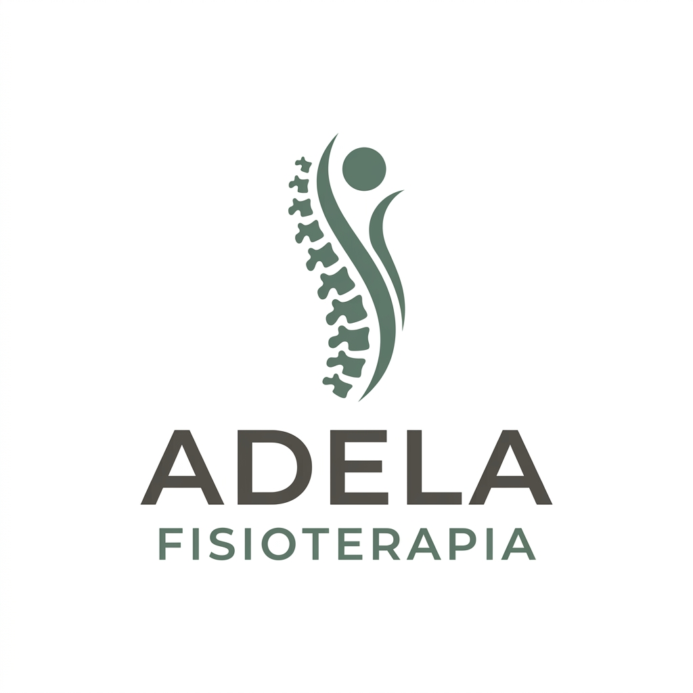
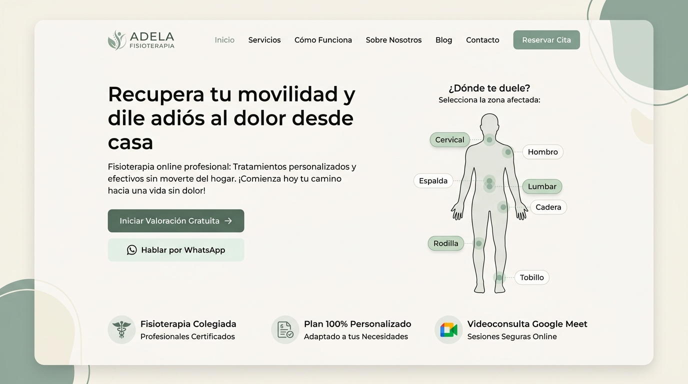
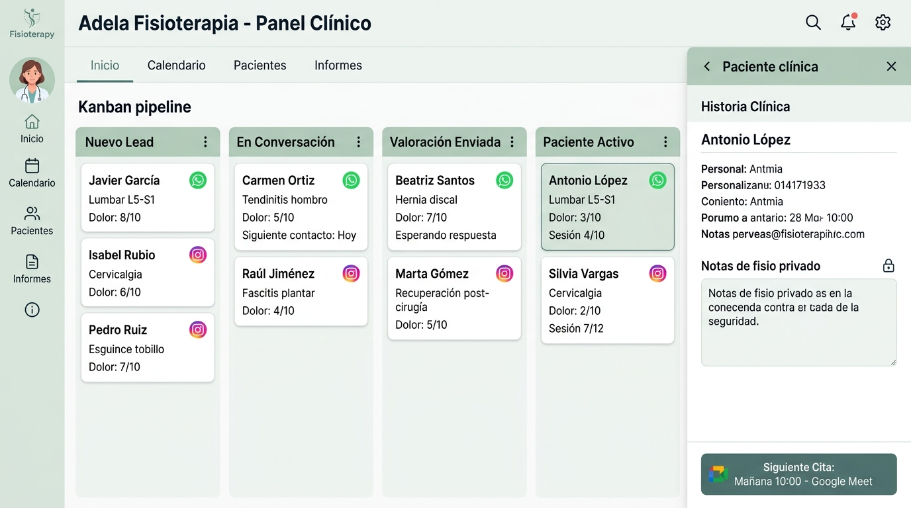
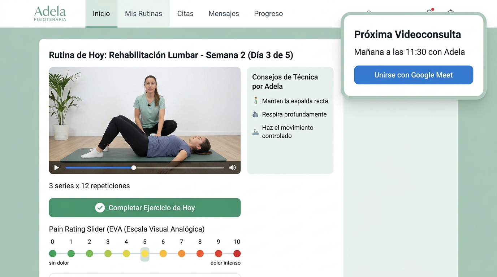

# Dossier de Presentación & Mockups Visuales
## Adela Alventosa — Fisioterapia Online (Col. Nº 4.812)

Este documento reúne la propuesta integral de **identidad visual, experiencia de usuario y arquitectura de interfaces** para presentar a Adela Alventosa antes del despliegue del VPS y Supabase.

---

### 1. Propuesta de Identidad Visual y Logotipo

Diseñado con un enfoque minimalista y sanitario contemporáneo:
* **Paleta:** Verde salvia sereno (#2D5A43), arena cálido (#FBF8F3) y gris pizarra neutro (#1E293B).
* **Isotipo:** Síntesis abstracta de la columna vertebral en movimiento y postura humana terapéutica.
* **Presencia de marca:** Logo oficial incorporado en la esquina superior izquierda de todas las pantallas (Web, CRM y Portal).

---

### 2. El Método Clínico de Adela (Visualización Estilo Excalidraw)

Arquitectura visual pedagógica que reduce el escepticismo inicial del paciente sobre el tratamiento online:
* **Fase 1: Valoración & Diagnóstico Inicial:** Cuestionario funcional y Meet de 45 minutos.
* **Fase 2: Plan de Ejercicios a Medida:** Vídeos en HD grabados por Adela con explicaciones paso a paso.
* **Fase 3: Feedback Diario & Reajuste Activo:** Escala EVA y mensajes de voz en WhatsApp.
* **Fase 4: Consolidación & Alta Terapéutica:** Fortalecimiento y pautas preventivas a largo plazo.
* **Fichero complementario:** Incluye diagrama vectorial importable en Excalidraw (`metodo-clinico-adela.excalidraw`).

---

### 3. Vista Pública: Landing Page & Cuestionario Clínico

Diseñada para inspirar máxima confianza y convertir visitantes en pacientes:
* **Titular enfocado a beneficio:** *"Recupera tu movilidad y dile adiós al dolor desde casa"*.
* **Selector visual anatómico fijo:** Silueta médica de alta definición con punto focal dinámico sin saltos de maquetación (Cervical, hombro, lumbar, cadera, rodilla, tobillo).
* **Consentimiento RGPD Sanitario (Art. 9):** Bloque legal destacado que recaba el consentimiento explícito antes de solicitar síntomas o antecedentes.
* **Integración Omnicanal:** Botón directo a WhatsApp/Instagram con bot IA (Zernio).

---

### 4. Vista de Gestión: El Panel Clínico de Adela (CRM Kanban)

La herramienta de trabajo diaria de la fisioterapeuta:
* **Pipeline Kanban Visual:** Columnas de estado (`Nuevo Lead`, `En Conversación`, `Valoración Enviada`, `Paciente Activo`).
* **Insignias de canal:** Identificación inmediata de si el lead proviene de WhatsApp (verde) o Instagram (rosa) mediante Zernio.
* **Ficha de Paciente Integrada:** Historial, motivo de consulta y **Estrategia / Notas clínicas privadas** con candado (inaccesibles por el paciente mediante RLS).
* **Agenda Directa:** Acceso a su calendario de Google y botón para lanzar **Google Meet**.

---

### 5. Bandeja Omnicanal de Conversaciones

Módulo específico para gestionar toda la interacción con los pacientes:
* **Bandeja unificada con filtros:** Todas, WhatsApp, Instagram y Portal del Paciente.
* **Historial médico de mensajes:** Conversaciones completas por paciente con insignias de canal.
* **Plantillas de respuesta rápida:** Mensajes clínicos precargados (Confirmar Meet, Pedir vídeo del ejercicio, Modificar series).

---

### 6. Informes & Métricas de Negocio

Panel analítico para que Adela y José Miguel conozcan la salud financiera y clínica de la clínica:
* **KPIs Clave:** Clientes Activos (28), Total Histórico (142), Facturación Mensual (3.240 €), Ratio de Conversión (34,2%), Adherencia a Rutinas (88,5%), Reducción EVA (-4,8 pts).
* **Embudo de Conversión Omnicanal:** Visitas (1.240) → Cuestionarios (82) → Meets (38) → Pacientes Activos (28).
* **Desglose de Ingresos por Modalidad:** Plan Híbrido, Plan Rutinas y Sesiones Sueltas.
* **Evolución Clínica de Pacientes:** Tabla comparativa de dolor EVA inicial vs actual y tasa de adherencia.

---

### 7. Vista del Paciente: Portal Web y Móvil

La experiencia que vive el paciente durante su tratamiento:
* **Rutina de hoy en vídeo:** Ejercicio pautado con instrucciones clínicas de Adela y series/repeticiones.
* **Registro diario de adherencia y dolor:** Escala EVA visual del 0 al 10 con un solo clic.
* **Videoconsulta Confirmada:** Tarjeta con acceso directo a la sala de Google Meet sin descargas ni configuraciones complejas.

---

### 8. Prototipo Interactivo en Vivo

Para que Adela pueda navegar e interactuar en directo con todas estas vistas y módulos:
* **Dossier Web:** Abre `VER PRESENTACION.html` en el navegador.
* **Prototipo Interactivo:** Abre `mockup_interactivo.html` en cualquier navegador web.
